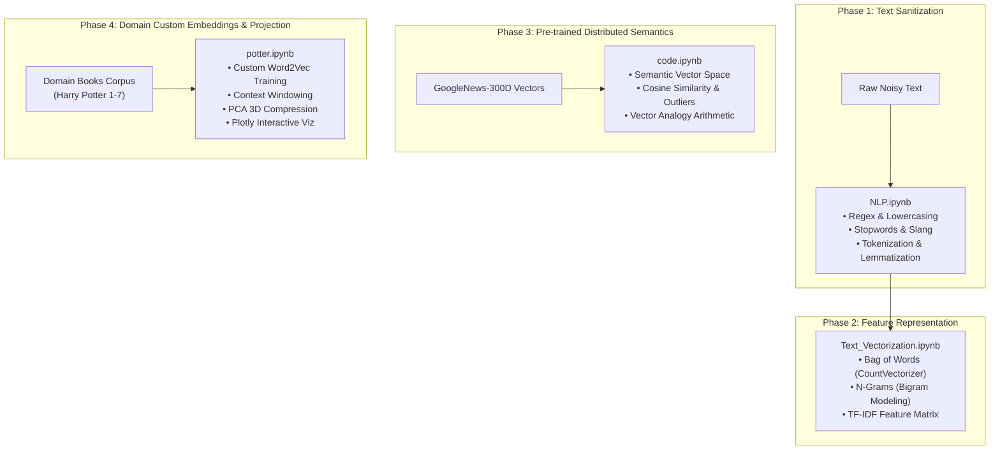

# 🤖 Natural Language Processing & Word Embeddings Mastery

[](https://www.python.org/)
[](https://jupyter.org/)
[](https://www.nltk.org/)
[](https://spacy.io/)
[](https://scikit-learn.org/)
[](https://radimrehurek.com/gensim/)
[](https://plotly.com/)
[](https://opensource.org/licenses/MIT)

Welcome to the **NLP & Word Embeddings** repository! This repository contains a curated, 4-part progressive learning curriculum spanning text cleaning, feature extraction (vectorization), pre-trained word embeddings, and training domain-specific custom Word2Vec neural architectures from scratch with 3D vector space visualization.

---

## 🗂️ Curriculum & Repository Modules

| # | Notebook | Dedicated Documentation | Focus & Key Concepts | Primary Libraries |
| :-: | :--- | :--- | :--- | :--- |
| **01** | [`NLP.ipynb`](./NLP.ipynb) | [📘 Text Cleaning README](./README_NLP.md) | Lowercasing, HTML tag stripping, URL removal, punctuation removal, slang expansion, spelling correction, stopwords, emoji demojization, tokenization (Python, NLTK, spaCy), stemming, lemmatization. | `pandas`, `re`, `nltk`, `spacy`, `textblob`, `emoji` |
| **02** | [`Text_Vectorization.ipynb`](./Text_Vectorization.ipynb) | [📊 Vectorization README](./README_Text_Vectorization.md) | IMDB sentiment review exploration, Bag of Words (BoW), CountVectorizer, N-Grams (Bigrams), and TF-IDF (Term Frequency - Inverse Document Frequency) mathematical weighting. | `pandas`, `scikit-learn` |
| **03** | [`code.ipynb`](./code.ipynb) | [🧠 Pretrained Word2Vec README](./README_code.md) | GoogleNews-vectors-negative300 (300D embeddings), semantic cosine similarity, category outlier detection (`doesnt_match`), and vector arithmetic analogies ($\text{King} - \text{Man} + \text{Woman} = \text{Queen}$). | `gensim`, `numpy` |
| **04** | [`potter.ipynb`](./potter.ipynb) | [⚡ Custom Word2Vec & 3D Viz README](./README_potter.md) | End-to-end custom Word2Vec model trained on Harry Potter Books 1–7 corpus, semantic association discovery for fantasy entities, PCA dimensionality reduction, and interactive 3D scatter visualization. | `gensim`, `nltk`, `scikit-learn`, `plotly` |

---

## 🚀 Learning Path & Technical Workflow



---

## 📁 Repository Directory Structure

```text
├── NLP.ipynb                           # Module 1: Text Cleaning & Preprocessing
├── README_NLP.md                       # Comprehensive guide for Module 1
├── train_data_cleaning.csv             # Training dataset for text cleaning
├── test_data_cleaning.csv              # Test dataset for tokenization/lemmatization
│
├── Text_Vectorization.ipynb            # Module 2: Bag of Words, Bigrams & TF-IDF
├── README_Text_Vectorization.md        # Comprehensive guide for Module 2
│
├── code.ipynb                          # Module 3: Pre-trained Word2Vec Embeddings
├── README_code.md                      # Comprehensive guide for Module 3
│
├── potter.ipynb                        # Module 4: Custom Word2Vec & 3D Visualization
├── README_potter.md                    # Comprehensive guide for Module 4
├── Book1.txt ... Book7.txt             # Harry Potter Books 1 to 7 raw text files
│
└── README.md                           # Master Repository README (this file)
```

---

## ⚙️ Quickstart & Environment Setup

### 1. Clone the Repository
```bash
git clone https://github.com/<your-username>/nlp-word-embeddings.git
cd nlp-word-embeddings
```

### 2. Set Up Python Virtual Environment
```bash
python -m venv venv

# On Windows:
venv\Scripts\activate

# On macOS/Linux:
source venv/bin/activate
```

### 3. Install All Dependencies
```bash
pip install pandas numpy scikit-learn==1.3.0 gensim nltk spacy textblob emoji plotly jupyter
```

### 4. Download Language Resources & Corpora
```bash
# NLTK resources
python -c "import nltk; nltk.download('punkt'); nltk.download('stopwords'); nltk.download('wordnet'); nltk.download('omw-1.4')"

# TextBlob corpora
python -m textblob.download_corpora

# spaCy English pipeline
python -m spacy download en_core_web_sm
```

### 5. Launch Jupyter Notebook
```bash
jupyter notebook
```

---

## 🌐 External Model Weights (Module 3)
For Module 3 (`code.ipynb`), download Google's pre-trained Word2Vec binary:
- **File Name:** `GoogleNews-vectors-negative300.bin`
- **Download Source:** [Kaggle GoogleNews Vectors Dataset](https://www.kaggle.com/datasets/leadbest/googlenewsvectorsnegative300)
- Place the downloaded `.bin` file in your project path and update `path` in `code.ipynb`.

---

## 📤 GitHub Push Commands

To upload this repository to GitHub:
```bash
# 1. Initialize git
git init

# 2. Add .gitignore for large files and checkpoints
echo "*.bin" >> .gitignore
echo ".ipynb_checkpoints/" >> .gitignore
echo "__pycache__/" >> .gitignore
echo "venv/" >> .gitignore

# 3. Stage and commit files
git add .
git commit -m "Add documented NLP curriculum notebooks and comprehensive README files"

# 4. Set main branch and remote repository
git branch -M main
git remote add origin https://github.com/<your-username>/<your-repo-name>.git

# 5. Push to GitHub
git push -u origin main
```

---

## 📜 License
This repository is licensed under the [MIT License](https://opensource.org/licenses/MIT).
