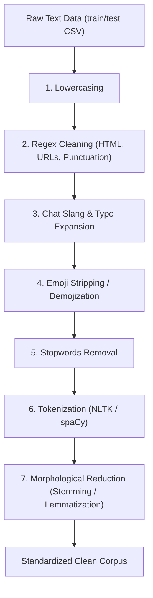

# 📖 Text Cleaning & Preprocessing in Natural Language Processing (`NLP.ipynb`)

[](https://www.python.org/)
[](https://jupyter.org/)
[](https://www.nltk.org/)
[](https://spacy.io/)
[](https://textblob.readthedocs.io/)
[](https://opensource.org/licenses/MIT)

A comprehensive, hands-on guide and reference notebook for essential **Text Cleaning, Normalization, and Preprocessing** workflows in NLP. Raw natural language text is inherently noisy, unstructured, and filled with non-textual artifacts (HTML tags, URLs, emojis, slang, spelling mistakes, and grammatical inflections). This project implements and demonstrates standard data engineering pipelines required before feeding text into machine learning algorithms or transformer models.

---

## 📑 Table of Contents
- [Project Overview](#-project-overview)
- [Workflow Architecture](#-workflow-architecture)
- [Key NLP Techniques Explained](#-key-nlp-techniques-explained)
  - [1. Text Normalization (Lowercasing)](#1-text-normalization-lowercasing)
  - [2. Noise Removal (HTML Tags, URLs, Punctuations)](#2-noise-removal-html-tags-urls-punctuations)
  - [3. Slang and Chat Abbreviation Expansion](#3-slang-and-chat-abbreviation-expansion)
  - [4. Spelling Correction](#4-spelling-correction)
  - [5. Stopword Removal](#5-stopword-removal)
  - [6. Emoji Handling & Demojization](#6-emoji-handling--demojization)
  - [7. Tokenization (Python vs. NLTK vs. spaCy)](#7-tokenization-python-vs-nltk-vs-spacy)
  - [8. Stemming vs. Lemmatization](#8-stemming-vs-lemmatization)
- [Project Structure](#-project-structure)
- [Installation & Environment Setup](#-installation--environment-setup)
- [Code Walkthrough & Pipeline Stages](#-code-walkthrough--pipeline-stages)
- [Troubleshooting & Known Quirks](#-troubleshooting--known-quirks)
- [GitHub Upload Guide](#-github-upload-guide)
- [License](#-license)

---

## 🔍 Project Overview

Before machine learning models (like Naive Bayes, Logistic Regression, or Neural Networks) can process natural language, the text must be normalized into clean linguistic tokens. This notebook demonstrates:
- How to eliminate irrelevant patterns (HTML markup, hyperlinks, symbols).
- How to standardize informal social media chatter and emojis.
- How to segment sentences and extract words accurately.
- How morphological analysis (stemming and lemmatization) reduces vocabulary dimensionality.

---

## 🔄 Workflow Architecture



---

## 🧠 Key NLP Techniques Explained

### 1. Text Normalization (Lowercasing)
- **Why it matters:** Text algorithms treat `"Apple"`, `"apple"`, and `"APPLE"` as three distinct vocabulary tokens if unnormalized.
- **Implementation:** Vectorized Pandas `.str.lower()` converts the entire vocabulary to a consistent lowercase representation, drastically shrinking feature sparsity.

### 2. Noise Removal (HTML Tags, URLs, Punctuations)
- **HTML Stripping:** Regular expression `<.*?>` matches any opening or closing HTML tags non-greedily and removes them.
- **URL Removal:** Pattern `https?://\S+|www\.\s+` matches both secure/insecure web URLs and domain strings.
- **Punctuation Stripping:** Regex character class negation `[^\w\s]` isolates and removes all characters that are neither word characters (`a-z`, `A-Z`, `0-9`, `_`) nor whitespace.

### 3. Slang and Chat Abbreviation Expansion
- Social media conversations contain ubiquitous shorthand (e.g. `"asap"` $\rightarrow$ `"As soon as possible"`, `"lol"` $\rightarrow$ `"laugh out loud"`).
- Using a dictionary mapping with `.get(word, word)` swaps abbreviations while leaving standard vocabulary untouched.

### 4. Spelling Correction
- Misspelled words fragment the vocabulary matrix.
- `TextBlob.correct()` applies spelling probability models and minimum edit distance (Levenshtein distance) algorithms to suggest and replace the most likely correct English word.

### 5. Stopword Removal
- High-frequency words such as `"the"`, `"is"`, `"at"`, `"which"`, and `"on"` carry minimal semantic discrimination for topic categorization.
- NLTK's English stopword corpus contains 179 standard stopwords used to prune non-discriminative noise.

### 6. Emoji Handling & Demojization
- **Removal:** Stripping Unicode ranges (`\U0001F600-\U0001F64F`, etc.) for applications where emojis represent clutter.
- **Demojization:** Using `emoji.demojize()` converts `🍕` into `:pizza:`. In sentiment analysis, retaining emotional indicators as text tokens improves model accuracy.

### 7. Tokenization (Python vs. NLTK vs. spaCy)
| Method | Description | Handling of Complex Tokens (`Ph.D`, `email@test.com`) |
| :--- | :--- | :--- |
| `str.split()` | Splits purely on whitespace. | Naive: retains attached punctuation (`"A.I!"`). |
| `nltk.word_tokenize` | Rule-based Penn Treebank tokenizer. | Separates punctuation into distinct tokens. |
| `spacy.load('en_core_web_sm')` | Production pipeline tokenizer with statistical linguistic models. | Aware of syntactic context, email addresses, and contractions. |

### 8. Stemming vs. Lemmatization
- **Stemming (Porter Stemmer):** A heuristic rule-based approach that chops off suffixes (e.g. `running` $\rightarrow$ `run`, `stories` $\rightarrow$ `stori`). Fast, but may produce non-words.
- **Lemmatization (WordNet Lemmatizer):** A dictionary-based morphological approach that computes the valid grammatical root lemma using Part-of-Speech context (e.g. `better` with `pos='a'` $\rightarrow$ `good`).

---

## 📁 Project Structure

```text
├── NLP.ipynb                   # Main documented Jupyter Notebook
├── train_data_cleaning.csv     # Sample training dataset for cleaning
├── test_data_cleaning.csv      # Sample test dataset for preprocessing
└── README.md                   # Detailed project documentation
```

---

## ⚙️ Installation & Environment Setup

### 1. Clone or Download Repository
```bash
git clone https://github.com/<your-username>/<repo-name>.git
cd <repo-name>
```

### 2. Create Virtual Environment
```bash
python -m venv venv
# On Windows:
venv\Scripts\activate
# On Linux/macOS:
source venv/bin/activate
```

### 3. Install Dependencies
```bash
pip install pandas nltk spacy textblob emoji
```

### 4. Download External NLP Corpora
```bash
# NLTK datasets
python -c "import nltk; nltk.download('stopwords'); nltk.download('punkt'); nltk.download('wordnet'); nltk.download('omw-1.4')"

# TextBlob corpora
python -m textblob.download_corpora

# spaCy English small pipeline model
python -m spacy download en_core_web_sm
```

---

## 💻 Code Walkthrough & Pipeline Stages

### Stage 1: Lowercasing & HTML Stripping
```python
import pandas as pd
import re

# Lowercasing
text = "Hello World"
clean_lower = text.lower()

# Stripping HTML
raw_html = "<h1>Hello I am Gururaj</h1>"
clean_text = re.sub(r'<.*?>', "", raw_html)
# Output: "Hello I am Gururaj"
```

### Stage 2: Slang Dictionary Replacement
```python
slang_dict = {'asap': "As soon as possible", 'gn': "good morning", 'lol': "laugh out loud"}

def expand_slang(text, slang_dict):
    words = text.split()
    return " ".join([slang_dict.get(word, word) for word in words])

expand_slang("Hey call me asap", slang_dict)
# Output: "Hey call me As soon as possible"
```

### Stage 3: Stopword Filtering
```python
from nltk.corpus import stopwords
english_stops = set(stopwords.words('english'))

sample_sentence = "Hey how are you i am fine I was looking for you"
filtered_tokens = [w for w in sample_sentence.split() if w.lower() not in english_stops]
# Output: ['Hey', 'fine', 'looking']
```

### Stage 4: Stemming vs Lemmatization
```python
from nltk.stem import PorterStemmer, WordNetLemmatizer

ps = PorterStemmer()
lemmatizer = WordNetLemmatizer()

word = "running"
print("Stemmed:", ps.stem(word))                    # Output: 'run'
print("Lemmatized (verb):", lemmatizer.lemmatize(word, pos='v')) # Output: 'run'

word2 = "better"
print("Lemmatized (adjective):", lemmatizer.lemmatize(word2, pos='a')) # Output: 'good'
```

---

## ⚠️ Troubleshooting & Known Quirks

1. **`python -m textblob.download_corpora` inside a Jupyter cell:**
   - *Issue:* Executing raw shell commands without `!` causes `SyntaxError: invalid syntax`.
   - *Solution:* In Jupyter Notebooks, run with an exclamation point prefix: `!python -m textblob.download_corpora` or execute directly in your terminal.
2. **DLL load failed while importing `_regex` on Windows:**
   - *Issue:* Occurs when C++ runtime libraries are missing or an incompatible regex wheel is installed.
   - *Solution:* Reinstall regex cleanly: `pip install --force-reinstall regex`.
3. **`lemmatizer.lematize()` Typo:**
   - *Issue:* Calling `lematize` with a single 'm' raises `AttributeError: 'WordNetLemmatizer' object has no attribute 'lematize'`.
   - *Solution:* The correct method name is `lemmatizer.lemmatize()`.
4. **`nltk.download('onw-1.4')` Typo:**
   - *Issue:* The Open Multilingual WordNet package identifier is `omw-1.4` (letter 'm' instead of 'n').
   - *Solution:* Run `nltk.download('omw-1.4')`.

---

## 🚀 GitHub Upload Guide

```bash
git init
git add NLP.ipynb README.md train_data_cleaning.csv test_data_cleaning.csv
git commit -m "Add documented NLP text cleaning and preprocessing notebook"
git branch -M main
git remote add origin https://github.com/<your-username>/<your-repo-name>.git
git push -u origin main
```

---

## 📄 License
This project is licensed under the MIT License - feel free to use and adapt for academic and research purposes.
