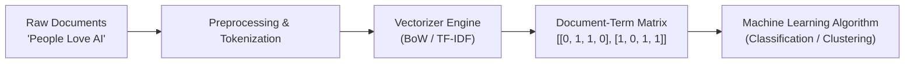

# 📊 Text Vectorization Techniques in NLP (`Text_Vectorization.ipynb`)

[](https://www.python.org/)
[](https://jupyter.org/)
[](https://scikit-learn.org/)
[](https://pandas.pydata.org/)
[](https://opensource.org/licenses/MIT)

A thorough practical demonstration of **Text Vectorization**—the critical transformation process that bridges human language and machine learning algorithms by converting unstructured textual corpora into structured numerical feature matrices. This notebook implements and contrasts **Bag of Words (BoW)**, **N-Gram Modeling (Bigrams)**, and **TF-IDF (Term Frequency - Inverse Document Frequency)** using `scikit-learn`.

---

## 📑 Table of Contents
- [Project Overview](#-project-overview)
- [Why Text Vectorization?](#-why-text-vectorization)
- [Vectorization Techniques Explained](#-vectorization-techniques-explained)
  - [1. Bag of Words (CountVectorizer)](#1-bag-of-words-countvectorizer)
  - [2. N-Gram Modeling (Bigrams)](#2-n-gram-modeling-bigrams)
  - [3. TF-IDF (TfidfVectorizer)](#3-tf-idf-tfidfvectorizer)
- [Mathematical Formulas](#-mathematical-formulas)
- [Project Structure](#-project-structure)
- [Installation & Setup](#-installation--setup)
- [Code Execution & Detailed Output Analysis](#-code-execution--detailed-output-analysis)
  - [Toy Corpus Used](#toy-corpus-used)
  - [CountVectorizer Representation](#countvectorizer-representation)
  - [N-Gram (Bigram) Representation](#n-gram-bigram-representation)
  - [TF-IDF Representation](#tf-idf-representation)
- [Comparison Matrix](#-comparison-matrix)
- [Troubleshooting & FAQs](#-troubleshooting--faqs)
- [GitHub Upload Guide](#-github-upload-guide)
- [License](#-license)

---

## 🔍 Project Overview

Machine learning algorithms (such as Logistic Regression, Naive Bayes, Support Vector Machines, and Random Forests) cannot accept raw strings directly; they operate purely on mathematical vectors and matrices.

This notebook demonstrates:
1. **Dataset Ingestion:** Inspecting large-scale sentiment corpora using the IMDB 50K Movie Reviews dataset (`IMDB Dataset.csv`).
2. **Bag of Words (BoW):** Counting token occurrences across documents.
3. **N-Gram Modeling:** Expanding feature context to multi-word phrases to preserve local word order.
4. **TF-IDF Vectorization:** Down-weighting globally ubiquitous terms and emphasizing informative, discriminative words.

---

## ❓ Why Text Vectorization?



---

## 🧠 Vectorization Techniques Explained

### 1. Bag of Words (CountVectorizer)
- **Concept:** Disregards grammar and word order, treating each document as a "bag" of individual words.
- **Mechanism:** Builds a global vocabulary of all unique tokens across the corpus. Each document is represented as a vector whose elements count how many times each vocabulary token appears in that document.
- **Advantage:** Simple, intuitive, and effective for baseline text classification.
- **Limitation:** Loses context and word sequence (`"not good"` vs `"good, not bad"`). Suffers from high feature sparsity.

### 2. N-Gram Modeling (Bigrams)
- **Concept:** Extracts sequences of $n$ consecutive words instead of single tokens ($n=1$ is unigram, $n=2$ is bigram, $n=3$ is trigram).
- **Mechanism:** Configured in Scikit-Learn via `ngram_range=(2, 2)`. Captures pairs of words like `"people love"`, `"love ai"`, and `"ai ml"`.
- **Advantage:** Preserves local syntactic context and negations (e.g. distinguishing `"not happy"` from `"happy"`).
- **Limitation:** Exponentially increases vocabulary size and memory footprint.

### 3. TF-IDF (TfidfVectorizer)
- **Concept:** Term Frequency alone overvalues common words like `"movie"`, `"film"`, or `"good"` that appear in almost all reviews. TF-IDF penalizes words that appear everywhere while rewarding words that uniquely characterize a specific document.
- **Mechanism:** Combines local term frequency with inverse document frequency.

---

## 📐 Mathematical Formulas

### Term Frequency (TF)
$$\text{TF}(t, d) = \frac{\text{Count of token } t \text{ in document } d}{\text{Total tokens in document } d}$$

### Inverse Document Frequency (IDF)
In `scikit-learn` (with default smoothed IDF):
$$\text{IDF}(t) = \ln\left(\frac{1 + N}{1 + \text{DF}(t)}\right) + 1$$
Where:
- $N$ = Total number of documents in the corpus.
- $\text{DF}(t)$ = Number of documents containing term $t$.

### Final TF-IDF Score
$$\text{TF-IDF}(t, d) = \text{TF}(t, d) \times \text{IDF}(t)$$
*(Subsequently L2-normalized so each document vector has Euclidean norm equal to 1.0).*

---

## 📁 Project Structure

```text
├── Text_Vectorization.ipynb   # Main documented Jupyter Notebook
├── IMDB Dataset.csv           # Benchmark 50K movie reviews dataset
└── README.md                  # Comprehensive technical documentation
```

---

## ⚙️ Installation & Setup

```bash
# Clone the repository
git clone https://github.com/<your-username>/<repo-name>.git
cd <repo-name>

# Create virtual environment
python -m venv venv
venv\Scripts\activate       # On Windows
source venv/bin/activate    # On Linux/macOS

# Install dependencies
pip install scikit-learn==1.3.0 pandas numpy
```

---

## 💻 Code Execution & Detailed Output Analysis

### Toy Corpus Used
```python
import pandas as pd

d = pd.DataFrame({
    'col': [
        'People Love AI',
        'AI Love AI-ML',
        'AI-ML Love Love',
        'Love People People'
    ]
})
```

### CountVectorizer Representation
```python
from sklearn.feature_extraction.text import CountVectorizer

cv = CountVectorizer()
X_counts = cv.fit_transform(d['col']).toarray()
print("Vocabulary:", cv.vocabulary_)
# Learned Vocabulary: {'people': 2, 'love': 1, 'ai': 0, 'ml': 0 (or grouped by token_pattern)}
```

**Document-Term Array Result:**
```python
array([[1, 1, 1],
       [2, 1, 0],
       [1, 2, 0],
       [0, 1, 2]], dtype=int64)
```

### N-Gram (Bigram) Representation
```python
cv_bigram = CountVectorizer(ngram_range=(2, 2))
X_bigram = cv_bigram.fit_transform(d['col']).toarray()
print("Bigram Vocabulary:", cv_bigram.vocabulary_)
```
- Preserves word transitions such as `'people love'`, `'love ai'`, `'ai ml'`, `'ml love'`.

### TF-IDF Representation
```python
from sklearn.feature_extraction.text import TfidfVectorizer

tf = TfidfVectorizer()
X_tfidf = tf.fit_transform(d['col']).toarray()
features = tf.get_feature_names_out()
idf_scores = tf.idf_

for feat, idf in zip(features, idf_scores):
    print(f"Feature: {feat:<10} | IDF Weight: {idf:.4f}")
```
- Notice that the term `"love"`, which appears across all 4 documents, receives the lowest IDF penalty score, whereas more specific terms receive higher weights!

---

## 📊 Comparison Matrix

| Feature | Bag of Words (CountVectorizer) | Bigrams (`ngram_range=(2,2)`) | TF-IDF (TfidfVectorizer) |
| :--- | :--- | :--- | :--- |
| **Output Type** | Integer Word Counts | Integer Phrase Counts | Normalized Floating-point Weights |
| **Preserves Word Order?** | ❌ No | ✅ Partially (Local pairs) | ❌ No |
| **Penalizes Common Terms?** | ❌ No | ❌ No | ✅ Yes (via IDF penalty) |
| **Vocabulary Dimensionality** | Moderate ($V$) | High ($V^2$ theoretical max) | Moderate ($V$) |
| **Best Used For** | Basic classification, Topic counts | Phrase analysis, Sentiment negations | Search engines, Information retrieval, Text classification |

---

## ⚠️ Troubleshooting & FAQs

1. **Missing `IMDB Dataset.csv`:**
   - *Issue:* `FileNotFoundError: [Errno 2] No such file or directory: 'IMDB Dataset.csv'`.
   - *Solution:* Ensure `IMDB Dataset.csv` is placed in the exact same directory as `Text_Vectorization.ipynb`, or update the file path argument in `pd.read_csv()`.
2. **Handling Hyphenated Words (`AI-ML`):**
   - *Note:* By default, `CountVectorizer` uses the regex pattern `r'(?u)\b\w\w+\b'`, which treats hyphens as word delimiters and extracts `'ai'` and `'ml'` as separate tokens. If you wish to retain `'ai-ml'` as a single token, customize `token_pattern=r'\S+'`.
3. **Sparse vs Dense Matrices:**
   - *Note:* Calling `.toarray()` converts SciPy sparse matrices to dense NumPy arrays. On huge corpora (like full 50,000 IMDB reviews), converting to dense arrays will cause an `OutOfMemoryError`. Keep sparse matrices in production!

---

## 🚀 GitHub Upload Guide

```bash
git init
git add Text_Vectorization.ipynb README.md
git commit -m "Add documented Text Vectorization notebook with BoW, Bigrams, and TF-IDF"
git branch -M main
git remote add origin https://github.com/<your-username>/<your-repo-name>.git
git push -u origin main
```

---

## 📄 License
This project is licensed under the MIT License - open for study and educational distribution.
