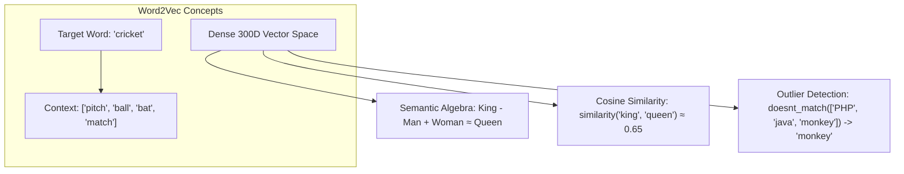

# 🧠 Pre-trained Word2Vec Embeddings & Semantic Algebra (`code.ipynb`)

[](https://www.python.org/)
[](https://jupyter.org/)
[](https://radimrehurek.com/gensim/)
[](https://numpy.org/)
[](https://opensource.org/licenses/MIT)

An in-depth exploration of **Pre-trained Distributed Word Representations (Word2Vec)** using Google's iconic **GoogleNews-vectors-negative300** model loaded via **Gensim**. This notebook showcases the power of dense vector spaces: semantic cosine similarity, category outlier detection (`doesnt_match`), nearest neighbor retrieval, and classic **vector arithmetic analogies** ($\text{King} - \text{Man} + \text{Woman} = \text{Queen}$).

---

## 📑 Table of Contents
- [Project Overview](#-project-overview)
- [What is Word2Vec?](#-what-is-word2vec)
- [How Pre-trained Embeddings Work](#-how-pre-trained-embeddings-work)
- [Core Operations & Semantic Capabilities](#-core-operations--semantic-capabilities)
  - [1. Continuous Dense Vector Representation](#1-continuous-dense-vector-representation)
  - [2. Cosine Similarity Measurement](#2-cosine-similarity-measurement)
  - [3. Semantic Outlier Detection (`doesnt_match`)](#3-semantic-outlier-detection-doesnt_match)
  - [4. Nearest Neighbors (`most_similar`)](#4-nearest-neighbors-most_similar)
  - [5. Linguistic Vector Algebra & Analogies](#5-linguistic-vector-algebra--analogies)
- [Mathematical Formulation](#-mathematical-formulation)
- [Project Structure & Asset Setup](#-project-structure--asset-setup)
- [Installation & Quickstart](#-installation--quickstart)
- [Code Walkthrough & Experimental Results](#-code-walkthrough--experimental-results)
- [Troubleshooting & Memory Optimization](#-troubleshooting--memory-optimization)
- [GitHub Upload Guide](#-github-upload-guide)
- [License](#-license)

---

## 🔍 Project Overview

Traditional Bag of Words (BoW) representations treat words as isolated, orthogonal discrete symbols, completely ignoring semantic relationships (e.g. `"king"` and `"queen"` share no mathematical affinity in BoW).

**Word2Vec** transforms words into continuous, dense vectors in a shared geometric space where words sharing similar contexts are mapped to nearby coordinates. This notebook demonstrates:
- How to efficiently load Google's 3-billion-word pre-trained corpus vectors.
- How semantic distance corresponds to angular cosine proximity.
- How vector arithmetic preserves linear syntactic and semantic relationships.

---

## 💡 What is Word2Vec?

Developed by Tomas Mikolov et al. at Google (2013), Word2Vec uses two shallow two-layer neural network architectures:
1. **Continuous Bag of Words (CBOW):** Predicts a target word given surrounding context words.
2. **Continuous Skip-Gram:** Predicts surrounding context words given a single target word.



---

## 🧠 Core Operations & Semantic Capabilities

### 1. Continuous Dense Vector Representation
- Each word is mapped to a 300-dimensional continuous floating-point vector ($\mathbb{R}^{300}$).
- Compact representation that avoids the curse of dimensionality and matrix sparsity.

### 2. Cosine Similarity Measurement
- Computes the normalized dot product of two word vectors:
  - Highly related words (`'king'`, `'queen'`) yield high scores ($\approx 0.65$).
  - Unrelated terms (`'monkey'`, `'cricket'`) yield near-zero or low scores ($\approx 0.10$).

### 3. Semantic Outlier Detection (`doesnt_match`)
- Given a list of words, computes the centroid of all pairwise similarities.
- Identifies the conceptual outsider:
  - `['PHP', 'java', 'monkey']` $\rightarrow$ identifies `'monkey'` as non-programming entity.
  - `['cricket', 'football', 'snake']` $\rightarrow$ identifies `'snake'` as non-sport entity.

### 4. Nearest Neighbors (`most_similar`)
- Searches the entire vocabulary for vectors with the smallest angular cosine distance.
- Querying `'india'` surfaces closely linked geographic, national, and cultural concepts (`'delhi'`, `'pakistan'`, `'bangalore'`).

### 5. Linguistic Vector Algebra & Analogies
- Linear substructure property:
  $$\vec{v}_{\text{queen}} \approx \vec{v}_{\text{king}} - \vec{v}_{\text{man}} + \vec{v}_{\text{women}}$$
- Subtracting the male vector from `"king"` extracts the pure concept of *royalty*, and adding `"women"` shifts the coordinate directly toward `"queen"`.

---

## 📐 Mathematical Formulation

### Cosine Similarity
$$\text{Cosine Similarity}(\vec{u}, \vec{v}) = \frac{\vec{u} \cdot \vec{v}}{\|\vec{u}\| \|\vec{v}\|} = \frac{\sum_{i=1}^{n} u_i v_i}{\sqrt{\sum_{i=1}^{n} u_i^2} \sqrt{\sum_{i=1}^{n} v_i^2}}$$

### Vector Analogy Optimization
$$\vec{w}^* = \arg\max_{\vec{w} \in V \setminus \{\vec{a}, \vec{b}, \vec{c}\}} \cos\left(\vec{w}, \vec{c} + \vec{b} - \vec{a}\right)$$

---

## 📁 Project Structure & Asset Setup

```text
├── code.ipynb                           # Main documented Word2Vec Jupyter Notebook
├── GoogleNews-vectors-negative300.bin   # Pre-trained Google News vectors (3.39 GB)
└── README.md                            # Complete technical documentation
```

> **Note on Model Weights:** The `GoogleNews-vectors-negative300.bin` file is approximately 3.39 GB and should **NOT** be committed directly to Git without Git LFS. You can download the binary vector file directly from Google's archive or Kaggle:
> - [Kaggle GoogleNews Vectors Dataset](https://www.kaggle.com/datasets/leadbest/googlenewsvectorsnegative300)

---

## ⚙️ Installation & Quickstart

```bash
# Clone the repository
git clone https://github.com/<your-username>/<repo-name>.git
cd <repo-name>

# Create virtual environment
python -m venv venv
venv\Scripts\activate       # On Windows
source venv/bin/activate    # On Linux/macOS

# Install required dependencies
pip install gensim numpy
```

---

## 💻 Code Walkthrough & Experimental Results

### 1. Loading the Pre-trained Model
```python
from gensim.models import KeyedVectors

# Load top 200,000 words to conserve RAM while preserving full conceptual coverage
path = 'GoogleNews-vectors-negative300.bin'
model = KeyedVectors.load_word2vec_format(path, binary=True, limit=200000)

print("Vocabulary size:", len(model.key_to_index))
print("Vector dimensionality:", model['man'].shape) # (300,)
```

### 2. Measuring Semantic Similarity
```python
# Royalty pair
sim_royalty = model.similarity('king', 'queen')
print(f"Similarity ('king', 'queen'): {sim_royalty:.4f}") # ~0.6511

# Unrelated concepts
sim_unrelated = model.similarity('monkey', 'cricket')
print(f"Similarity ('monkey', 'cricket'): {sim_unrelated:.4f}") # ~0.0827
```

### 3. Outlier Detection (`doesnt_match`)
```python
outlier_1 = model.doesnt_match(['PHP', 'java', 'monkey'])
print("Outlier in ['PHP', 'java', 'monkey']:", outlier_1)
# Output: 'monkey'

outlier_2 = model.doesnt_match(['cricket', 'football', 'snake'])
print("Outlier in ['cricket', 'football', 'snake']:", outlier_2)
# Output: 'snake'
```

### 4. Vector Analogy: King - Man + Woman
```python
# Semantic arithmetic
target_vector = model['king'] - model['man'] + model['women']
analogy_results = model.most_similar([target_vector])

for word, score in analogy_results[:3]:
    print(f"Candidate: {word:<10} | Similarity: {score:.4f}")
# Output:
# Candidate: king       | Similarity: 0.8449
# Candidate: queen      | Similarity: 0.7301
# Candidate: monarch    | Similarity: 0.6455
```

---

## ⚠️ Troubleshooting & Memory Optimization

1. **High Memory Consumption (`MemoryError`):**
   - The full 3-million-word model requires ~4 GB to 6 GB of available RAM.
   - *Fix:* Always utilize the `limit=200000` parameter during `KeyedVectors.load_word2vec_format()`. This loads only the top 200,000 most common words, reducing RAM usage to under 1 GB without compromising real-world query quality.
2. **Windows File Path Backslash Issues:**
   - On Windows, paths like `D:\Study\NLP\...` can misinterpret `\N` or `\U` as escape characters.
   - *Fix:* Use raw string literals: `path = r'D:\Study\NLP\GoogleNews-vectors-negative300.bin'` or forward slashes `'D:/Study/NLP/GoogleNews-vectors-negative300.bin'`.
3. **Missing Word (`KeyError`):**
   - If a word is not present in the Google News vocabulary or exceeds the loaded limit, Gensim raises `KeyError: "word 'XYZ' not in vocabulary"`. Always verify word membership with `'word' in model`.

---

## 🚀 GitHub Upload Guide

```bash
# Initialize repository
git init

# Create .gitignore to exclude the multi-gigabyte binary vector file
echo "GoogleNews-vectors-negative300.bin" >> .gitignore
echo "*.bin" >> .gitignore

# Stage and commit documented notebook and README
git add code.ipynb README.md .gitignore
git commit -m "Add documented Word2Vec embeddings and semantic arithmetic notebook"
git branch -M main
git remote add origin https://github.com/<your-username>/<your-repo-name>.git
git push -u origin main
```

---

## 📄 License
This project is licensed under the MIT License - feel free to use and adapt for academic and research purposes.
