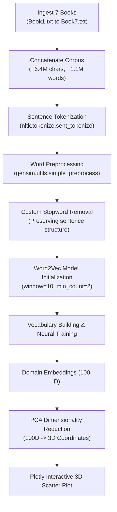

# ⚡ Custom Word2Vec Training on Harry Potter & 3D Vector Visualization (`potter.ipynb`)

[](https://www.python.org/)
[](https://jupyter.org/)
[](https://radimrehurek.com/gensim/)
[](https://www.nltk.org/)
[](https://scikit-learn.org/)
[](https://plotly.com/)
[](https://opensource.org/licenses/MIT)

A complete end-to-end NLP project that trains a **custom domain-specific Word2Vec neural embedding model** from scratch on the full literary corpus of **Harry Potter (Books 1 to 7)**. After training, the high-dimensional word vectors are compressed using **Principal Component Analysis (PCA)** and rendered into an interactive **3D Scatter Visualization** using **Plotly**.

---

## 📑 Table of Contents
- [Project Overview](#-project-overview)
- [End-to-End Pipeline Architecture](#-end-to-end-pipeline-architecture)
- [Corpus Data & Statistics](#-corpus-data--statistics)
- [NLP Preprocessing Pipeline](#-nlp-preprocessing-pipeline)
  - [1. Sentence Tokenization](#1-sentence-tokenization)
  - [2. Gensim `simple_preprocess`](#2-gensim-simple_preprocess)
  - [3. Stopword Filtering with Boundary Preservation](#3-stopword-filtering-with-boundary-preservation)
- [Word2Vec Training Mechanics](#-word2vec-training-mechanics)
  - [Hyperparameters Explained](#hyperparameters-explained)
  - [Vocabulary Construction & Neural Training](#vocabulary-construction--neural-training)
- [Semantic Queries & Literary Findings](#-semantic-queries--literary-findings)
- [Dimensionality Reduction & 3D Interactive Visualization](#-dimensionality-reduction--3d-interactive-visualization)
- [Project Directory Structure](#-project-directory-structure)
- [Installation & Setup](#-installation--setup)
- [Troubleshooting & Known Quirks](#-troubleshooting--known-quirks)
- [GitHub Upload Guide](#-github-upload-guide)
- [License](#-license)

---

## 🔍 Project Overview

Pre-trained models like GoogleNews Word2Vec are trained on generic journalistic news articles and lack domain-specific fantasy context (e.g. magic spells, mythical creatures, house names, and specific character relationships).

In this project, we:
1. Ingest all 7 original Harry Potter books into a unified corpus (~6.4 million characters, ~1.1 million words).
2. Clean and structure the text into sentence-level token streams.
3. Train a custom continuous word embedding space where context windows reflect J.K. Rowling's narrative world.
4. Discover that semantically related entities (e.g. `'voldemort'`, `'death'`, `'dark'`, `'riddle'`) cluster together automatically.
5. Project the 100-dimensional embeddings down to 3 dimensions using PCA and visualize them interactively in 3D.

---

## 🔄 End-to-End Pipeline Architecture



---

## 📚 Corpus Data & Statistics

The corpus consists of all seven canonical Harry Potter books:
- **Book 1:** *The Philosopher's / Sorcerer's Stone*
- **Book 2:** *The Chamber of Secrets*
- **Book 3:** *The Prisoner of Azkaban*
- **Book 4:** *The Goblet of Fire*
- **Book 5:** *The Order of the Phoenix*
- **Book 6:** *The Half-Blood Prince*
- **Book 7:** *The Deathly Hallows*

### Summary Metrics:
- **Total Characters:** ~6,460,000+
- **Total Words:** ~1,120,000+
- **Total Extracted Sentences:** ~80,000+
- **Learned Vocabulary:** ~20,000+ unique tokens (with `min_count=2`)

---

## 🛠️ NLP Preprocessing Pipeline

### 1. Sentence Tokenization
Word2Vec context windows must not cross disjoint sentence boundaries. We first segment the full corpus into distinct sentences using `nltk.tokenize.sent_tokenize`.

### 2. Gensim `simple_preprocess`
Converts raw sentence strings into token lists:
- Lowercases every character.
- Strips punctuation and digits.
- Extracts valid tokens with length between 2 and 15 characters.

### 3. Stopword Filtering with Boundary Preservation
A custom function iterates through each sentence and discards non-discriminative English stopwords while preserving the nested list structure:
```python
def stopword_removal(text):
    cleaned_text = []
    for sentence in text:
        new_sentence = [word for word in sentence if word.lower() not in stopwords]
        cleaned_text.append(new_sentence)
    return cleaned_text
```

---

## ⚙️ Word2Vec Training Mechanics

```python
import gensim

# Model Initialization
model = gensim.models.Word2Vec(
    window=10,      # Considers 10 context words left and right (broad thematic capture)
    min_count=2,    # Ignores words occurring only once (eliminates typos)
    vector_size=100,# Gensim default continuous dimension (100 dimensions)
    workers=4       # Multi-threaded CPU worker threads
)

# Build Vocabulary & Train
model.build_vocab(cleaned_potter)
model.train(cleaned_potter, total_examples=model.corpus_count, epochs=model.epochs)
```

### Hyperparameters Explained:
- `window=10`: A larger window size captures broader topical and narrative associations (e.g., characters and their associated spells, houses, or artifacts).
- `min_count=2`: Trims single-instance typos and obscure OCR errors, reducing vocabulary dimensionality and speeding up training.
- `epochs=5`: Standard number of passes over the corpus during gradient descent backpropagation.

---

## 🔮 Semantic Queries & Literary Findings

Querying the custom model reveals how accurately it learned the semantic relationships of the magical universe:

```python
# Semantic nearest neighbors for 'voldemort'
model.wv.most_similar('voldemort')
```
**Sample Narrative Associations Learned:**
- `'riddle'` (his original surname)
- `'death'` / `'eaters'`
- `'dark'` / `'lord'`
- `'dumbledore'` (his primary adversary)
- `'wand'` / `'avada'`

```python
# Word vector dimensionality
len(model.wv['harry'])
# Output: 100
```

---

## 🌌 Dimensionality Reduction & 3D Interactive Visualization

Because humans cannot visualize 100-dimensional vector spaces, we apply **Principal Component Analysis (PCA)** to compute the 3 orthogonal directions of maximum variance:

```python
from sklearn.decomposition import PCA
import plotly.express as px

# 1. Normalize Vectors to unit length (L2 norm = 1.0)
normed_vectors = model.wv.get_normed_vectors()

# 2. Fit PCA down to 3 components
pca = PCA(n_components=3)
X_3d = pca.fit_transform(normed_vectors)

# 3. Extract Vocabulary Labels
words = model.wv.index_to_key

# 4. Generate Interactive 3D Plot for Top 100 Words
fig = px.scatter_3d(
    X_3d[:100],
    x=0, y=1, z=2,
    color=words[:100],
    text=words[:100],
    title="3D PCA Projection of Top 100 Harry Potter Word Embeddings"
)
fig.update_traces(textposition='top center')
fig.show()
```

---

## 📁 Project Directory Structure

```text
├── potter.ipynb       # Main documented Jupyter Notebook
├── Book1.txt          # Book 1: Sorcerer's Stone
├── Book2.txt          # Book 2: Chamber of Secrets
├── Book3.txt          # Book 3: Prisoner of Azkaban
├── Book4.txt          # Book 4: Goblet of Fire
├── Book5.txt          # Book 5: Order of the Phoenix
├── Book6.txt          # Book 6: Half-Blood Prince
├── Book7.txt          # Book 7: Deathly Hallows
└── README.md          # Comprehensive technical documentation
```

---

## ⚙️ Installation & Setup

```bash
# Clone the repository
git clone https://github.com/<your-username>/<repo-name>.git
cd <repo-name>

# Create virtual environment
python -m venv venv
venv\Scripts\activate       # On Windows
source venv/bin/activate    # On Linux/macOS

# Install dependencies
pip install gensim nltk scikit-learn plotly pandas numpy

# Download NLTK tokenizers and stopwords
python -c "import nltk; nltk.download('punkt'); nltk.download('stopwords')"
```

---

## ⚠️ Troubleshooting & Known Quirks

1. **Typo in `model.biuld_vocab()`:**
   - *Issue:* `AttributeError: 'Word2Vec' object has no attribute 'biuld_vocab'`.
   - *Solution:* The method name contains a slight typo (`iu` instead of `ui`). The correct Gensim method name is `model.build_vocab(cleaned_potter)`.
2. **Variable Name Mismatch in Plotly Display:**
   - *Issue:* In cell 40, `fit = px.scatter_3d(...)` is defined, but `fig.show()` is called, raising `NameError: name 'fig' is not defined`.
   - *Solution:* Either assign to `fig`: `fig = px.scatter_3d(...)` and then `fig.show()`, or call `fit.show()`.
3. **Plotly Browser Renderer on Headless Machines:**
   - Setting `pio.renderers.default = 'browser'` opens the visualization in an active web browser window. If running inside JupyterLab or VSCode, you can set `pio.renderers.default = 'notebook'` or `'iframe'`.

---

## 🚀 GitHub Upload Guide

```bash
git init
git add potter.ipynb README.md
# Note: You can include Book1.txt through Book7.txt or note text corpus availability
git add Book*.txt
git commit -m "Add custom Harry Potter Word2Vec training and 3D visualization notebook"
git branch -M main
git remote add origin https://github.com/<your-username>/<your-repo-name>.git
git push -u origin main
```

---

## 📄 License
This educational project is licensed under the MIT License. Harry Potter text content and related character trademarks are the property of J.K. Rowling and Warner Bros. Entertainment Inc. Used strictly for non-commercial educational and NLP research purposes.
